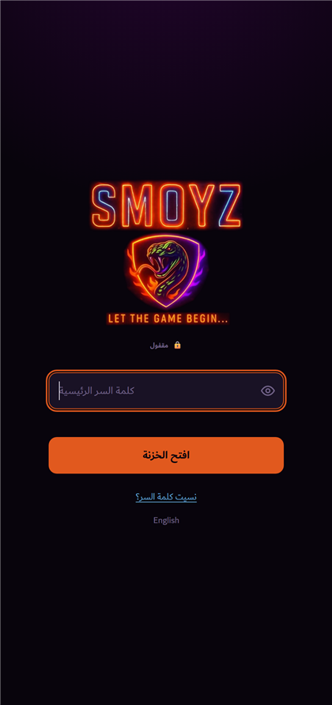
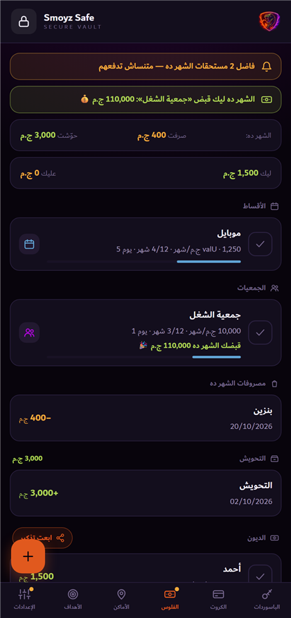
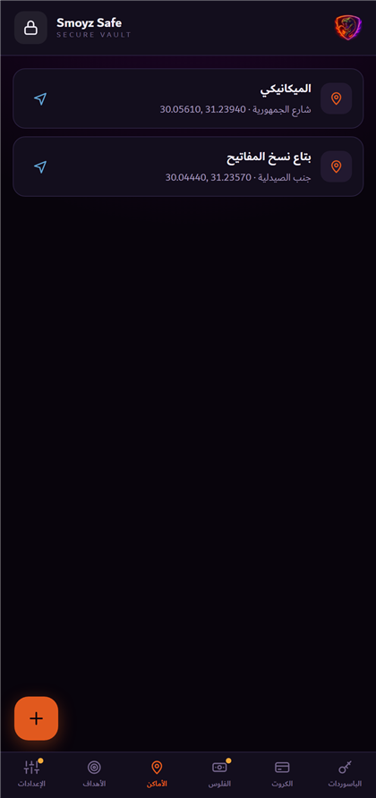
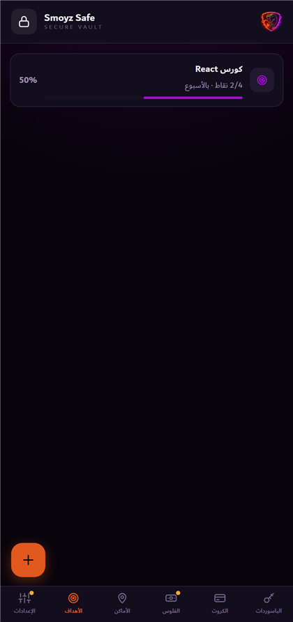



### خزنتك الشخصية — على موبايلك وبس

باسورداتك، كروت البنك، فلوسك وأقساطك، أماكنك وأهدافك — كلها متشفّرة على جهازك. 
مفيش سيرفر، مفيش حساب، ومحدش يقدر يفتحها غيرك.

[**📲 نزّل للأندرويد**](https://smoyz.github.io/smoyz-safe/download.html) &nbsp;·&nbsp; [**🌐 افتحه من المتصفح**](https://smoyz.github.io/smoyz-safe/)

أندرويد 7 فأحدث · 566 كيلوبايت · شغّال من غير نت · عربي و English

---

   

---

## إيه اللي جواه؟

| | |
|---|---|
| 🔑 **الباسوردات** | كل حساباتك وإيميلاتها، مع مولّد باسوردات قوية ونسخ بضغطة |
| 💳 **كروت البنك** | الأرقام والـ CVV مخفيين ومتشفّرين، والتطبيق بيعرف نوع الكارت لوحده |
| 💰 **الفلوس** | اللي ليك واللي عليك، ومصروفاتك وتحويشك بملخص شهري |
| 📅 **الأقساط** | جهة التمويل وشهر أول قسط وعدّاد الشهور، وتنبيه بميعاد كل قسط |
| 🤝 **الجمعيات** | بيحسبلك هتقبض كام وإمتى، والصافي بعد خصم قسط شهر القبض |
| 📍 **الأماكن** | احفظ موقعك بضغطة، وافتحه بعدين في الخرايط أو تطبيق نقل |
| 🎯 **الأهداف** | قسّم هدفك نقط بالأسبوع أو بالشهر وعلّم على اللي خلصته |
| 📤 **تذكير السلف** | اختار اللي عليهم فلوس، والتطبيق يكتب الرسالة وتبعتها واتساب |

## ليه تأمنله؟

- 🔐 **تشفير AES-256-GCM** بمفتاح مشتق من كلمة سرك (PBKDF2، 600 ألف دورة)
- 📵 **مفيش سيرفر ولا حساب** — بياناتك عمرها ما بتسيب موبايلك
- 👆 **بصمتك** بتفتح الخزنة، والمفتاح محفوظ جوه شريحة الأمان بتاعة الموبايل
- 📸 **ممنوع تصوير الشاشة** جوه التطبيق، وبيقفل لوحده لما تسيبه
- 🧹 **الكليبورد بيتمسح** بعد 40 ثانية من نسخ أي باسورد
- 🔒 **الصلاحيات أقل حاجة ممكنة**: الموقع لما تدوس "حدد موقعي" بس، والإنترنت لفحص التحديثات بس — وشاشة الخزنة نفسها **مقفولة عن الشبكة بالكود**

> [!IMPORTANT]
> **كلمة السر الرئيسية مالهاش استرجاع.** مفيش سيرفر عنده نسخة منها، وده بالظبط اللي بيخلي بياناتك مستحيل حد يوصلها. احفظها كويس، فعّل البصمة كخط نجاة، واعمل نسخة احتياطية من الإعدادات كل فترة.

## التحديثات

التطبيق بيشيّك لوحده وبيقولك أول ما ينزل إصدار جديد، وبيثبّته من جواه. وكل تحديث بيتركّب فوق القديم **من غير ما بياناتك تتمسح**.

## الأسئلة الشائعة

<b>نسيت كلمة السر، أعمل إيه؟</b>
 

لو مفعّل البصمة: افتح بيها وغيّر كلمة السر من الإعدادات. غير كده مفيش طريقة — لازم تمسح الخزنة وتبدأ من جديد، أو تسترجع نسخة احتياطية فاكر كلمة سرها.

<b>عندي آيفون؟</b>
 

افتح [نسخة الويب](https://smoyz.github.io/smoyz-safe/) في Safari ← زرار المشاركة ← **إضافة إلى الشاشة الرئيسية**، وهيبقى شكله ومعاملته زي أي تطبيق. بياناتك متشفّرة على الآيفون زي الأندرويد بالظبط.

<b>ليه أندرويد بيحذّرني وأنا بثبّته؟</b>
 

لأنه مش منزّل من جوجل بلاي. التطبيق موقّع رقميًا، والتطبيق نفسه بيرفض أي تحديث مش موقّع بنفس المفتاح. تقدر تتأكد من بصمة الملف (SHA-256) المكتوبة في [صفحة التحميل](https://smoyz.github.io/smoyz-safe/download.html).

<b>بياناتي بتروح فين لو ضاع الموبايل؟</b>
 

بتروح معاه — مفيش نسخة في أي مكان تاني. عشان كده **اعمل تصدير** من الإعدادات كل فترة؛ الملف اللي بيطلع متشفّر، تقدر تحفظه في أي مكان وترجّعه على أي جهاز.

<b>التطبيق مفتوح المصدر؟</b>
 

لأ. الكود مش منشور، والتطبيق متاح للاستخدام زي ما هو.

---

صُنع في مصر · <b>SMOYZ</b> · جميع الحقوق محفوظة

---

## English

**Your personal vault — on your phone, and nowhere else.**

Passwords, bank cards, money and installments, saved places and goals — all encrypted on your device. 
No server, no account, no one but you can open it.

[**📲 Download for Android**](https://smoyz.github.io/smoyz-safe/download.html) &nbsp;·&nbsp; [**🌐 Open in your browser**](https://smoyz.github.io/smoyz-safe/)

Everything is encrypted with **AES-256-GCM**, using a key derived from your master password with PBKDF2 (600,000 rounds). There is no server and no account — your data never leaves your phone. Unlock with your fingerprint, screenshots are blocked inside the app, it locks itself when idle, and the clipboard clears 40 seconds after you copy a secret.

The vault screen is **blocked from the network in code**; the only connection the app makes is checking for updates, and nothing installs unless it is signed with the original key.

> [!IMPORTANT]
> **The master password cannot be recovered.** No server holds a copy — which is exactly why nobody can reach your data. Keep it safe, enable fingerprint unlock as a lifeline, and export a backup from Settings now and then.

On iPhone, open the [web version](https://smoyz.github.io/smoyz-safe/) in Safari → Share → **Add to Home Screen**.

Not open source. Available to use as-is. © SMOYZ — All rights reserved.
